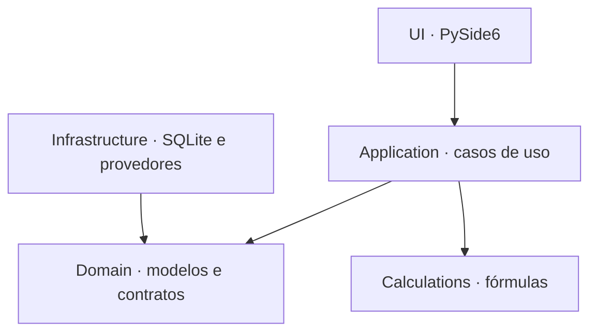

# Apresentação final — Nexo Invest (10 minutos)

Roteiro baseado na implementação revisada da `master` em 03/11/2026.
Use prints selecionados e comentados de métodos, nunca arquivos inteiros.
A demonstração principal usa **Apresentação**, com operações fictícias e mercado
online real, como em **Meu ambiente**. SQLite, histórico, posições a custo e
caixa permanecem locais. Sem internet/cobertura, métricas de mercado ficam
indisponíveis; não há substituição por preços fictícios.

## Sequência e tempo

| Tempo | Conteúdo | Evidência a mostrar |
|---|---|---|
| 0:00–1:00 | Problema, usuário e objetivo | Investidor iniciante organiza estratégias simuladas, movimentações e análises em um aplicativo desktop; motivação: informações dispersas. |
| 1:00–4:00 | Fluxo completo na interface | Criar carteira, abrir caixa, comprar, vender, rejeitar venda excessiva e reabrir para comprovar persistência. |
| 4:00–5:00 | Gráficos e integração | Selecionar Longo Prazo; mostrar concentração e custo versus valor de mercado. Identificar fonte/horário reais e mostrar SQLite. Preparar a consulta antes da aula. |
| 5:00–6:00 | Arquitetura | Diagrama abaixo e organização em UI, Application, Domain, Calculations e Infrastructure. |
| 6:00–7:30 | POO intencional | Três recortes: validação de Transaction, composição Position/Asset e contrato MarketDataProvider com implementações distintas. |
| 7:30–8:30 | Banco, API e erros | Ledger, Decimal, isolamento das carteiras, transação atômica; origem/horário e indisponibilidade das cotações. |
| 8:30–9:30 | Desafios e soluções | Replay de operações retroativas; dados de mercado incompletos; separação entre dados locais e mercado online. |
| 9:30–10:00 | Limites e evoluções | Correção auditável do ledger, manutenção individual de carteiras e acessibilidade; encerrar sem prometer recursos ausentes. |

Se precisar reduzir para oito minutos, retire a consulta de API ao vivo e resuma
as telas complementares. Se houver tempo, mostre Planejamento ou IA em até um
minuto; não substitua a explicação do núcleo por uma conversa longa com IA.

## Ensaio prático reproduzível

Abra Apresentação e crie uma carteira chamada `Ensaio final`. Ela começa vazia.
Use PETR4 e **preço manual** na boleta; os valores abaixo são didáticos. Escolha
datas/horários em ordem: abertura antes da compra, compra antes da venda.

| Ação | Entrada | Resultado esperado |
|---|---|---|
| Inicializar caixa em Movimentações | Saldo inicial R$ 1.000 | Caixa R$ 1.000 |
| Registrar compra | 10 PETR4 a R$ 20; taxas R$ 2 | 10 unidades; custo R$ 202; preço médio R$ 20,20; caixa R$ 798 |
| Registrar venda parcial | 4 PETR4 a R$ 25; taxas R$ 1 | 6 unidades; custo restante R$ 121,20; resultado realizado R$ 18,20; caixa R$ 897 |
| Tentar vender acima do saldo | 7 PETR4 | Recusa; posição, caixa e quantidade de registros permanecem iguais |
| Fechar e reabrir Apresentação | Selecionar Ensaio final novamente | Carteira, duas operações e saldo preservados |
| Selecionar Longo Prazo | Visão Geral | Operações de exemplo, gráficos e fonte/horário do mercado real identificados |

Ensaie uma vez antes e use outra carteira na apresentação. O modo Apresentação
preserva alterações; não repita o seed durante a sessão. Preços/indicadores de mercado exigem conexão e cobertura dos provedores. Retorno sobre custo é
uma fotografia das posições abertas; TWR diário é uma aproximação diferente.

## Diagrama da arquitetura efetiva

As setas representam dependências de código. `main.py` instancia os adaptadores
e os injeta nos casos de uso. Em execução, os casos de uso chamam os contratos;
os objetos concretos de Infrastructure fazem a leitura e a gravação.

## POO: recortes precisos para os slides

| Conceito | Arquivo / trecho para capturar | Explicação |
|---|---|---|
| Encapsulamento | `src/nexo/domain/models/transaction.py`: dataclass congelada, `__post_init__` e `amounts` | Valida quantidade/preço/taxas e mantém o cálculo da liquidação junto aos dados. Imutabilidade protege a operação criada. |
| Composição | `src/nexo/domain/models/position.py`: atributo `asset: Asset` | Uma posição contém um objeto de valor Asset; não há subclasses artificiais de ações e ETFs. |
| Composição de serviços | `src/nexo/application/portfolio/register_transaction.py`: construtor e `execute` | O caso de uso recebe um repository, em vez de abrir SQLite na interface. |
| Herança e polimorfismo | `MarketDataProvider`, `YahooFinanceProvider` e `BrapiMarketDataProvider` | Consultas usam implementações externas intercambiáveis por um contrato comum; dados fictícios ficam nas fixtures de testes. |
| Responsabilidade e persistência | `SqlAlchemyTransactionRepository.add_validated` | Reconstrói e valida o ledger sob `BEGIN IMMEDIATE` antes de gravar; falhas não deixam uma operação parcial. |

**Diferença em relação à proposta:** `Portfolio` é um objeto imutável com ID/nome.
Ele não contém uma lista de posições nem métodos de patrimônio. A reconstrução
ocorre em `rebuild_positions`, coordenada por serviços, e retorna
`ReconstructionResult` com posições abertas/encerradas. Explique a implementação
real, não apresente o desenho conceitual da proposta como uma classe existente.

## Integrações e modelo de dados

SQLite foi escolhido por ser local, dispensar servidor e facilitar a distribuição.
SQLAlchemy organiza o acesso. Tabelas: `portfolios`, `transactions`,
`portfolio_events`, `budget_entries`, `financial_goals` e `price_alerts`.
Transações/eventos referenciam a carteira; posições são calculadas, sem tabela
paralela. Valores monetários são texto no SQLite e `Decimal` no domínio.
O histórico da IA usa outro banco e não é a fonte do saldo financeiro.

No ambiente pessoal, Yahoo é a fonte pública principal; brapi, bolsai e CVM
complementam capacidades conforme configuração. Os adaptadores normalizam os
dados; chaves ficam em configuração externa e nunca devem aparecer nos prints.
Mostre fonte, moeda e horário da resposta, além da mensagem de indisponibilidade.
Sem conexão, a apresentação ainda comprova banco, caixa e gráficos de custo;
indicadores dependentes de mercado podem ficar indisponíveis. Fixtures não
comprovam acesso à API. Gemini é opcional e depende de chave,
internet e consentimento; validação com mocks não comprova autenticação real.

## Desafios que o código permite explicar

- Operações fora de ordem: reconstrução cronológica, validação de venda e caixa
  antes do commit; fonte única de verdade no ledger.
- Provedores incompletos/indisponíveis: contratos, cache, workers e apresentação
  explícita de indisponibilidade, fonte e horário.
- Entrega em outro computador: executável em pasta, dados fora do bundle,
  ledger local, indicação de indisponibilidade e configuração externa de credenciais.

Use essas decisões técnicas como exemplos; relate experiências pessoais apenas
se aconteceram com você. Para evolução, priorize edição/correção auditável,
renomear/remover carteira com regras próprias e validação em Windows limpo.
